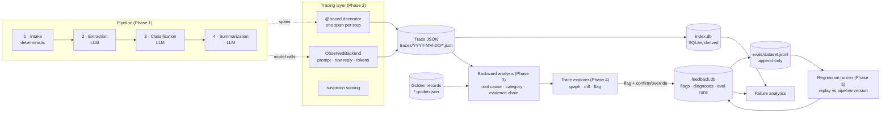
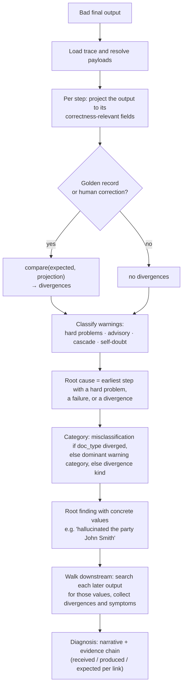
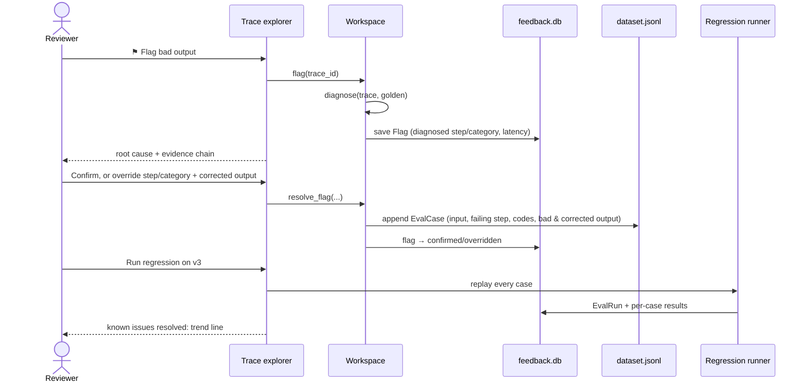

# obspipe architecture

> I built an observability system that cuts mean time to root cause for AI
> pipeline failures from hours of manual debugging to seconds of automated
> diagnosis.

When a multi-step AI pipeline gives a bad answer, the expensive question is
*which step broke*. Usually the step that looks wrong isn't the one that caused
it. A summary names a signatory who doesn't exist, but the summarizer only copied
what the extractor handed it. A contract summary has no effective date because
intake cut the document off before the date. obspipe records every step, reads
the record backwards to the first step that went wrong, explains how the error
spread, and turns each confirmed diagnosis into a regression test.

On the 50-document demo corpus, automated diagnosis takes **0.2 ms median per
trace** (measured; `obspipe analytics`). It names the right root-cause step and
category for all 13 designed failures and raises no false alarms on the 37 clean
documents (asserted in `tests/test_feedback.py`). The manual baseline is **not
measured** in this repo. "Hours" describes the usual alternative: opening trace
JSON, re-running steps by hand and diffing prompts.

---

## 1. System overview

| Layer | Code | Responsibility |
|---|---|---|
| Pipeline | `steps/`, `pipeline.py` | Four typed steps. Each one reports its own problems as `warnings[]` and never mutates its input. |
| Tracing | `tracing/`, `llm/observed.py` | Spans with full inputs and outputs, LLM calls, self-reported and measured confidence, suspicion. |
| Storage | `storage/` | JSON files are the source of truth. The SQLite index is derived and rebuildable. |
| Analysis | `analysis/` | Ground-truth projections, `compare`, `diagnose`, `step_diffs`. |
| Feedback | `feedback/`, `workspace.py` | Flags, eval cases, regression runs, analytics. One `Workspace` object is shared by the CLI and the web UI. |
| Explorer | `web/` | Stdlib HTTP server, JSON API, a vanilla-JS single-page app. No new dependencies. |
| Demo | `demo/` | Deterministic 50-document corpus with independent ground truth, and a history seeder. |

---

## 2. The backward analysis flow

**Why the earliest deviation is the root cause.** Data only flows forward. Step
*k* can't be blamed for what step *j < k* did. So the first step that deviates
is the cause, and every deviation after it is propagation until proven
otherwise. The hard part is deciding what counts as a deviation. Three kinds of
warning are deliberately excluded:

| Excluded | Example | Why |
|---|---|---|
| Advisory | `no_dates_found` on a contract with no dates | It describes the document, not a mistake. If ground truth says dates existed, the divergence convicts the step. |
| Cascade | `extracted_from_truncated_text` | It exists to say "the problem came from upstream". Counting it would convict the victim. |
| Self-doubt | `low_extraction_confidence` | Self-reported confidence is poorly calibrated. In live runs the model rated degraded spans 4.8/5. |

**Two modes, labelled on every diagnosis.**
- `ground_truth`: a golden record or a human correction exists, and divergence
  from it decides the result. This catches failures no check can see. The
  `misclassify` fault produces a confidently wrong label with zero warnings, and
  only ground truth exposes it.
- `heuristic`: no ground truth exists, so the step's own deterministic checks
  decide. Confidence is scaled by the step's suspicion score.

**Evidence chain.** Each link carries the specific input/output pair behind its
claim: what the step *received*, what it *produced*, and what it *should have
produced*. Here is the output for the corpus's `009_contract_lease`:

> Step 2 (Extraction) hallucinated the party 'John Smith', which does not appear
> in the source document. This propagated to Step 4 (Summarization), which
> included 'John Smith' in bullets[5] - "Parties involved: John Smith, Relecloud
> Inc, Adatum Health LLC." (and 1 more place(s)).

The propagation search is literal. The bad value from the root cause is searched
for in every downstream output, and each hit is reported with its JSON path.

### Projections: one shape for truth, corrections and reruns

A step's full output is large, and most of it doesn't decide correctness.
`analysis/golden.project()` reduces each output to a few normalized fields:

| Step | Projection |
|---|---|
| intake | `truncated`, `high_noise`, `char_count`, `sections` |
| extraction | `parties` (names), `dates` (ISO), `amounts` (`"1200.00 USD"`), `total` |
| classification | `doc_type`, `margin`, `scores` |
| summarization | `doc_type`, `effective_date`, `total_stated`, `parties` |

Golden records, human corrections typed into the flag dialog, and fresh eval
reruns all live in this shape. That is why the diff view, root-cause selection
and the eval pass condition all share one `compare()` function. Ground truth may
be partial (unlisted keys are not checked), and it may accept alternatives with
`{"any_of": [...]}` for a document that is honestly two things.

---

## 3. The feedback loop

**An eval case is self-contained.** It carries the document text, the run
conditions (backend, simulated faults), the failing step, the warning codes that
marked the failure, the bad projection and the corrected projection. The dataset
keeps working after the original trace files are gone.

**Pass condition.** A case is fixed when three things hold on a replay:
1. none of the failure codes recurs on the failing step,
2. the step's projection matches the corrected output, and
3. the step neither failed nor was skipped.

Condition 2 is what makes silent failures regression-testable. A
misclassification that tripped no check has no codes to watch, but its
correction (`{"doc_type": "invoice"}`) still fails until the label is right.

**Pipeline versions** make "fixed" mean something concrete. Each version is a
change an engineer would ship in response to a diagnosed failure class:

| Version | Change | Fixes |
|---|---|---|
| v1 | baseline: 12k intake budget, warn-only checks | - |
| v2 | intake budget raised to 48k | input truncation |
| v3 | v2 plus grounding guards: extraction drops ungrounded spans; summarization replaces an invented total with step 2's grounded one, or withholds it | hallucinated entities, unsupported figures |

The guards are real code (`steps/extraction.py::_drop_ungrounded`,
`steps/summarization.py::_strip_unsupported`), enabled through
`RunContext.extra`, so no step signature changed.

**Storage split.** `dataset.jsonl` is append-only and reviewable in a pull
request; it is the artifact you would commit. `feedback.db` holds human
decisions, so unlike `index.db` it is **not** derivable from the trace files and
is never rebuilt.

---

## 4. Failure analytics

Analytics aggregates the trace index, the cached diagnoses and the flags. Eval
replay traces (batch `eval-*`) are excluded so known failures aren't counted
twice.

| Metric | Source | The product question it answers |
|---|---|---|
| Most common failure types | diagnoses by category | What kind of fix buys the most? |
| Which step fails most | diagnoses by root-cause step | Where should engineering time go? |
| Step × category matrix | both | Which specific (step, failure) cell to attack first? |
| Failure rate over time | diagnoses per batch | Did the last release help? |
| Known issues resolved | eval runs | Are fixed bugs staying fixed? |
| Time to root cause | `computed_ms` (automated), flag → confirmation (human, seeded flags excluded) | How much faster is triage? |
| Diagnosis agreement | confirmed ÷ resolved flags | Can the automated diagnosis be trusted? |

Demo history (three batches of 50 documents, one per pipeline version):

| | batch-01 (v1) | batch-02 (v2) | batch-03 (v3) |
|---|---|---|---|
| failures | 13 / 50 | 11 / 50 | 8 / 50 |
| known issues resolved | 0 / 9 | 2 / 9 | 4 / 9 |

The five cases still failing at v3 (OCR damage, recall miss, normalization,
mixed-currency aggregation, timeout) are the backlog, ranked by the analytics.

---

## 5. Design decisions

- **Our own trace model, not OpenTelemetry.** An OTel attribute must be a
  primitive, and the whole point here is storing full step inputs and outputs.
  Payloads above 2 KB are content-addressed so a 20k-char document is stored
  once per trace.
- **Deterministic checks outrank model self-reports.** Every grounding,
  reconciliation and margin check is plain Python. The model's 1-5 rating is
  kept, but it is evidence of last resort.
- **Ground truth is written by the generator, not by the pipeline.** The demo
  generator chooses each document's parties, dates and amounts and writes the
  golden record from those choices. A snapshot of pipeline output would just
  certify the pipeline's own mistakes.
- **No web framework.** The explorer is a local tool over local files. Stdlib
  `http.server` plus one JS file adds zero dependencies, and each route is a
  thin call into `Workspace`.
- **The fake backend can reproduce model misbehaviour.** Named faults
  (`hallucinate_party`, `misclassify`, `call_timeout`, ...) make every failure
  class reproducible offline in tests and in eval replays. The same pipeline
  runs unchanged against Groq.

## 6. Limits

- Root-cause selection assumes a linear pipeline. A DAG would need the same rule
  applied per ancestor path.
- Heuristic mode can only see failures some check is written for. Silent
  failures need a golden record or a human flag, and that gap is exactly what
  the feedback loop closes.
- Demo "fixes" are pipeline-version configurations. Against a real model, the
  same eval set would measure a prompt or model change in the same way.
